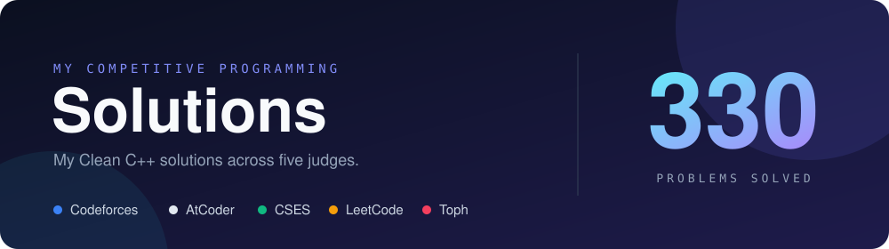
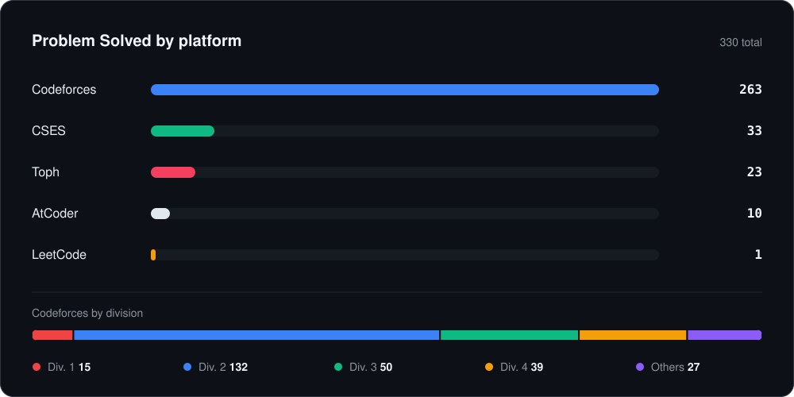
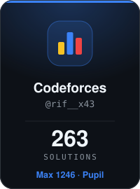
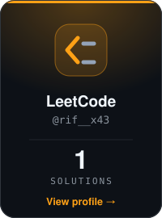
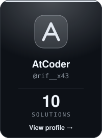
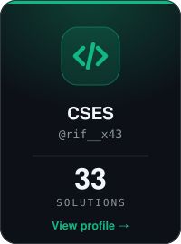
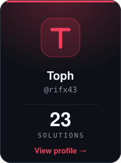

<p align="center">
  
</p>

<br>

## Overview

<p align="center">
  
</p>

<br>

## Profiles
 
<p align="center">
  <a href="https://codeforces.com/profile/rif__x43"></a>
  <a href="https://leetcode.com/u/rif__x43"></a>
  <a href="https://atcoder.jp/users/rif__x43"></a>
  <a href="https://cses.fi/user/USER_ID"></a>
  <a href="https://toph.co/p/rifx43"></a>
</p>
<br>

## Achievements
 
**Programming Contests**
 
- 🥇 **Champion, Junior Category** · Intra AUST Programming Contest Spring'25, AUSTPIC `2026`
- 🏅 **Ranked 5th** · Intra AUST Programming Contest, AUST CSE Carnival 8.0 `2026`
- 🏅 **Ranked 25th** · 9th DRMC International Tech Carnival Programming Contest, Preliminary `2026`
- 🎖️ **Finalist** · Intra AUST Programming Contest, AUST CSE Carnival 6.0 `2025`
- 🎟️ **Participated** · ICPC Asia Dhaka Regional, Preliminary Round `2026`
- 🎟️ **Participated** · ICPC Asia Dhaka Regional, Preliminary Round `2025`

<br>

## 📂 Browse
 
[`📁 AtCoder`](./AtCoder) &nbsp;·&nbsp;
[`📁 Codeforces`](./Codeforces) &nbsp;·&nbsp;
[`📁 CSES`](./CSES) &nbsp;·&nbsp; 
[`📁 LeetCode`](./LeetCode) &nbsp;·&nbsp; 
[`📁 Toph`](./Toph)
 
<details>

<br><br>
  
<summary><b>🗂️ Repository layout</b></summary>
```
AtCoder/
└── Beginner/
Codeforces/
├── Div. 1/
├── Div. 2/
├── Div. 3/
├── Div. 4/
└── Others/
CSES/
LeetCode/
└── Easy/
Toph/
└── Practice/
```
 
Each problem folder holds a `.cpp` solution and a `README.md` with the statement link, approach and complexity.
 
</details>
<br>

<p align="center">
  
</p>
<p align="center"><sub> ☕ Keep solving </sub></p>
